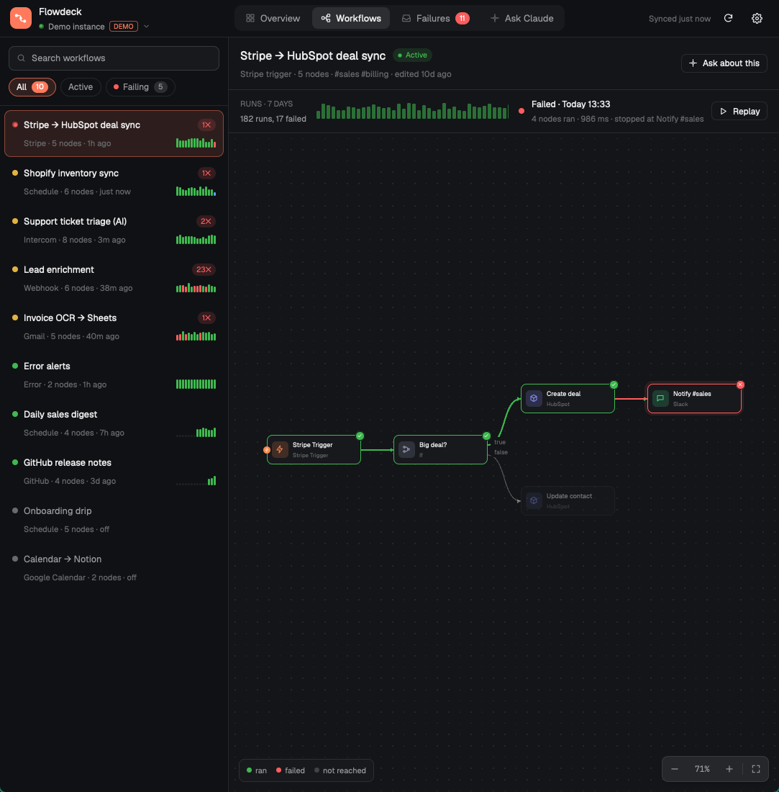
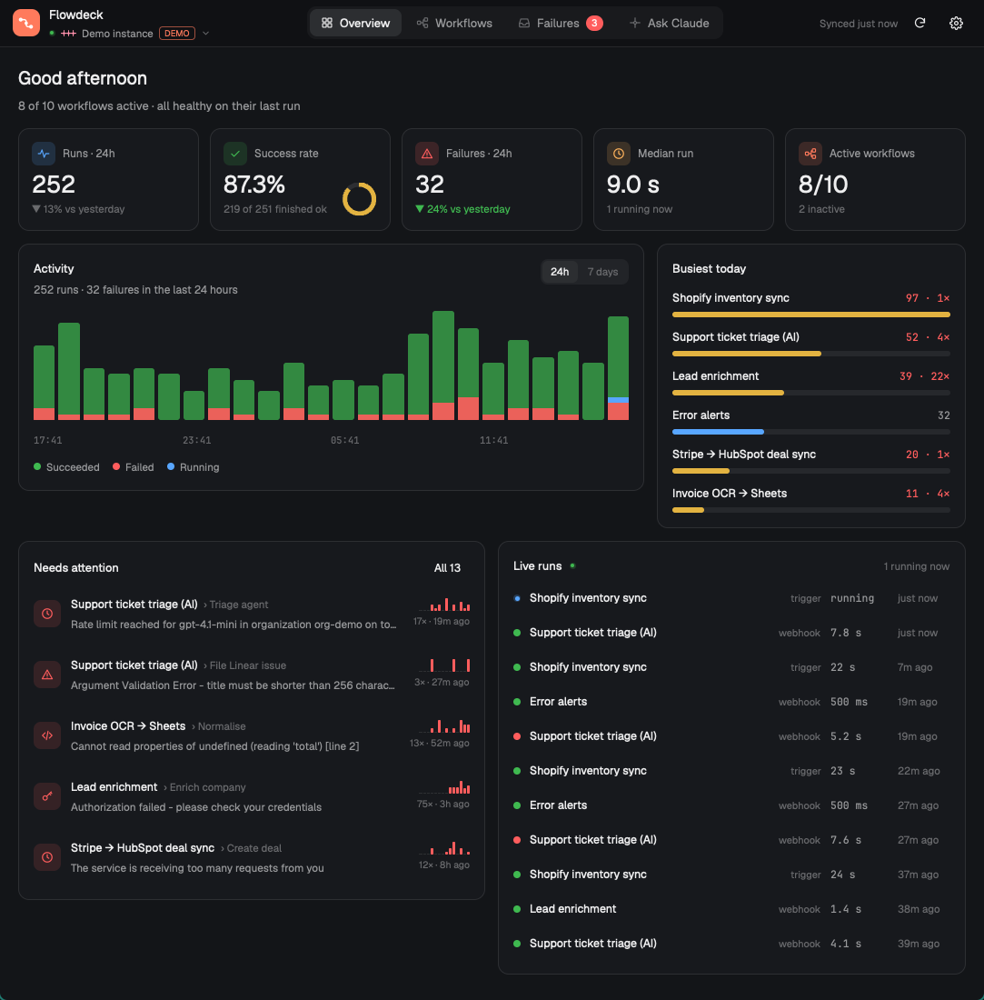
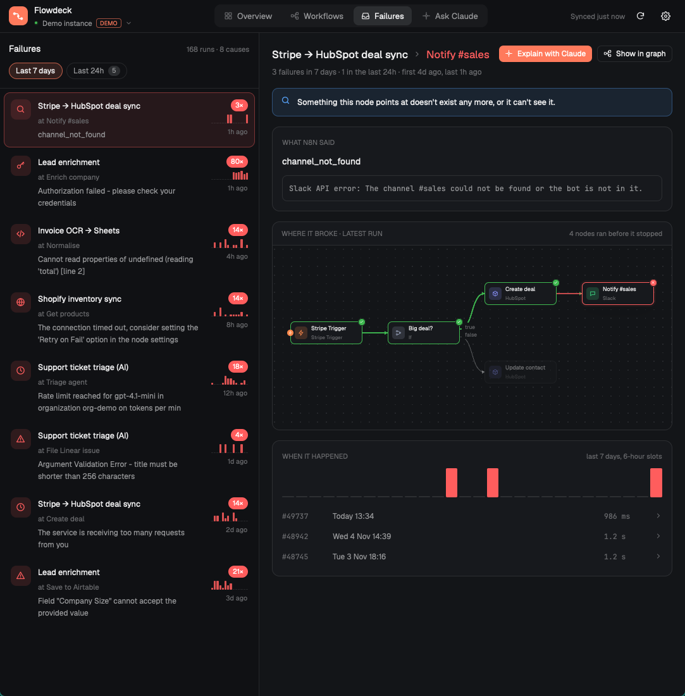
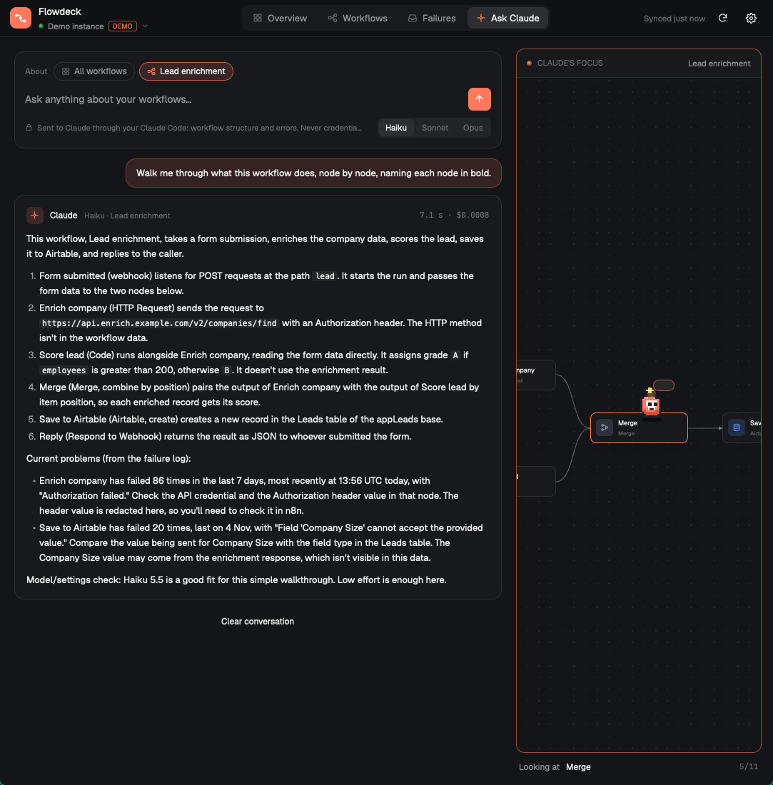

# Flowdeck for n8n

Your n8n instance in a [Herdr](https://herdr.dev) pane. Connect it with an API key, or an MCP token, and you get:

- **Overview**: how the instance is doing right now. Runs, success rate, failures and median duration over 24 hours, compared with yesterday. An hour-by-hour activity chart (or day by day for the week), the busiest workflows, what needs attention, and a live feed of runs as they land.
- **Workflows**: every workflow drawn as a live graph, laid out the way you arranged it in n8n. Pick any run from the strip above the graph and its path lights up: green for nodes that ran, red and pulsing for the one that failed, faded for nodes the run never reached. Replay walks a run node by node. Click a node to inspect its settings, with secrets hidden.
- **Failures**: a week of failures, grouped by workflow, node and error, so a run that failed 200 times is one line. Each group shows what n8n said, a first idea of why (expired credential, rate limit, timeout, bad data in a Code node, and so on), where it broke on the graph, and when it happened.
- **Ask Claude**: ask about the whole instance, one workflow or one failure: "Why is this failing?", "Which workflows haven't run this week?", "What does this one do, step by step?". The answer streams in through your own Claude Code. Ask from the Ask tab, or dock Claude beside the graph ("Ask about this", or "Explain with Claude" on a failure) and fold the workflow list into a rail to give the graph room.
- **Flo**: a little pixel-art bot who stands wherever the attention is. On a replay Flo hops node to node as the run plays, standing on the failing node with a red "!" (or a green ✓ when it finished). While Claude answers, Flo walks the graph in the order Claude names the nodes, and a scanning beam sweeps each one. When the answer is in, Flo goes to the node it blames, raises a red "!", and pins a pulsing **Likely cause** flag to it.
- **Alerts**: a Herdr toast the moment a run fails, with the failing node and the error. Clicking it brings you to Flowdeck.

There's a demo mode with a made-up instance, so you can try it before connecting anything.



| Overview | Failures | Ask Claude, with Flo following the answer |
|---|---|---|
|  |  |  |

## Install

Ask your agent: *"add the Herdr mod at github.com/SaifHarding/herdr-flowdeck"*. Or by hand:

```sh
cp -r mods/flowdeck ~/.config/herdr-app/mods/
herdr-app check ~/.config/herdr-app/mods/flowdeck
herdr-app do tab.new --name n8n --mod flowdeck
```

For a quick look without a tab, `mod.open:flowdeck` opens it as a large dialog, with a button that pops it out to a tab.

**Before you add it:** Flowdeck reaches the network (only your n8n address). It runs programs: `security` or `secret-tool` for the keychain, `claude` when you ask a question, and `open`/`xdg-open` for links. It reads and writes one private folder, `~/.config/herdr-app/.flowdeck` (mode 700), for a few seconds at a time. [SECURITY.md](SECURITY.md) covers each of these.

### Keys (optional)

Merge [keys.json](keys.json) into `~/.config/herdr-app/keys.json`:

- `ctrl-shift-n` opens Flowdeck in a new tab.
- While Flowdeck has focus: `ctrl-b` folds the workflow list. `ctrl-1` to `ctrl-4` switch views, `ctrl-r` refreshes, `ctrl-j`/`ctrl-k` move to the next or previous workflow or failure, `ctrl-shift-r` replays the selected run, and `ctrl-shift-a` docks Claude beside the selected workflow.

## Connecting

| | API key (recommended) | MCP token |
|---|---|---|
| Where | n8n → Settings → n8n API → Create an API key | n8n → Settings → Instance-level MCP → enable, copy the token |
| Workflows and graphs | yes | yes |
| Runs, failures, alerts | yes | no: n8n's MCP server doesn't share run history |
| Sent as | `X-N8N-API-KEY` header | `Authorization: Bearer` |

The address can be an n8n Cloud one (`https://you.app.n8n.cloud`) or self-hosted. Paste it however you copied it: `/home/workflows`, `/api/v1` and the like are trimmed off. Public addresses must be `https://`. Plain `http://` works for this machine (`localhost`). For a private network (`192.168.x.x`, `*.local`, Tailscale), you have to tick "Allow plain http on this network", and an amber HTTP badge stays in the header from then on.

You can connect several instances (production and staging, say) and switch between them from the instance menu in the header.

## Security, in short

- **Keys live in the macOS Keychain** or the Linux system keyring (GNOME Keyring or KWallet, through `secret-tool`). Where there's neither, a key lasts only until Herdr quits. A key is never written to settings, shared state, logs or a command line. Each key is tied to its instance's address, so it can't be redirected.
- **Read-only.** Flowdeck only ever sends GET requests to the REST API. Over MCP it calls only `search_workflows` and `get_workflow_details`; anything else is refused in code.
- **Your key goes only to your instance.** Herdr refuses to replay a key across a redirect to another host, and Flowdeck rejects any answer that came from a different address.
- **Claude sees only what you ask about, after you've said yes for that instance and scope.** "See exactly what's sent" shows the context word for word. It gets workflow structure and error messages. It never gets credentials, pinned data or the items your runs processed. Secrets in parameters, headers, bodies, URLs and code are masked first, by pattern, so check the preview if your workflows keep secrets outside n8n credentials. Claude runs with every tool, MCP server, hook and setting turned off. Answers are drawn without images or HTML, and their links only open your own workflow pages or n8n's docs.
- **Run data stays in memory** while the pane is open. Nothing about your workflows is written to disk.

Full details: [SECURITY.md](SECURITY.md).

## Requirements

- Herdr 0.1.13 (the version it was built and tested on).
- For Ask Claude: [Claude Code](https://claude.com/claude-code), signed in once with `claude`. Everything else works without it.
- On Linux, `secret-tool` (package `libsecret-tools`) to remember keys.

## Developing

```sh
node --test tests/*.test.js           # model, redaction, layout, URL and paging rules
node tools/mock-n8n.mjs 5679 &        # a fake n8n: REST API, MCP endpoint, a redirect trap
node tools/mock-n8n.mjs 5680 &        # catches any key that follows a redirect (logs LEAK)
```

The mock server's keys are `demo-key-0123456789abcdef` (API) and `mcp-token-0123456789abcdef` (MCP). Connect to `http://127.0.0.1:5679`.

Herdr's `herdr-app check` catches what the runtime refuses, but a `.js` file isn't syntax-checked by `node --check` (it treats it as CommonJS and skips it). Copy a file to `.mjs` to check it with Node.

## Licence

MIT. n8n is a trademark of n8n GmbH; Flowdeck is an independent project and isn't affiliated with or endorsed by n8n.
