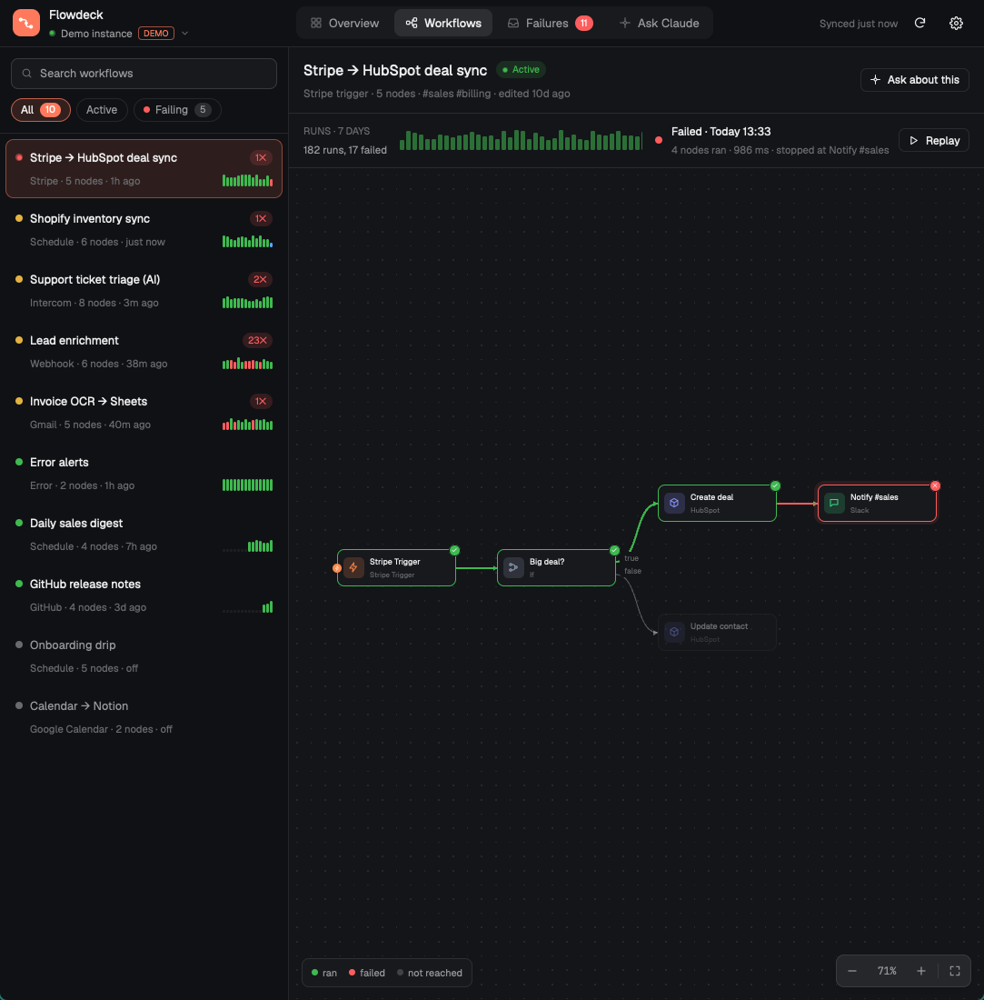

# Flowdeck for n8n

A pane that connects to an n8n instance with an API key and shows how it's doing. There's an overview of the last day, every workflow drawn as a live graph with any run laid over it, a week of failures grouped by cause, and a box for asking Claude about any of it. A toast fires the moment a run fails. A demo mode with a made-up instance lets people try it before connecting anything.

## What you see

The mod fills its pane (a tab: `tab.new {name: "n8n", mod: "flowdeck"}`). Every surface colour is the theme's (`canvas` behind, `surface` for cards, `chrome` for the header and side lists, `border`, `foreground`, `muted`, `dim`, `hover`, `raised`). Flowdeck's own colours are below; in light themes the darker value in brackets is used.

- Brand coral: `#ff7a5c` (`#e8553b`), with hover `#ffb35c`.
- Ok `#3fb950` (`#1a7f37`), error `#ff5d5d` (`#cf222e`), warning `#e3b341` (`#9a6700`) and running `#58a6ff` (`#0969da`).
- Node kinds: trigger `#ff8a4c`, flow `#9aa5bd`, code `#f2c14e`, HTTP `#4cc9f0`, AI `#c084fc`, data `#5b8def`, message `#3ddc84`, email `#2dd4bf`, other apps `#8b93ff`.

**Connect screen** (when no instance is connected). Behind everything, three soft lights drift slowly. Each is three concentric discs at 3.5–5% opacity, in coral, violet `#8b5cf6` and cyan `#22d3ee`. Centred in a 500 px column:

- A 52 px coral Flowdeck tile joined by three pulsing dots to a 52 px tile holding n8n's mark in n8n pink (`#ff91ac`, or `#e8436f` in light themes; the mark is `icons/n8n.svg` from n8n's design system), then the title "Connect your n8n" at 24 px semibold, and a one-line pitch.
- A 16 px-rounded card holding:
  - Three 38 px fields: instance address, the key (masked, with an eye toggle) and an optional name.
  - A switch: "Remember in macOS Keychain" (or "your system keyring"; disabled when neither exists).
  - Error and warning lines.
  - A coral Connect button and "Try with demo data".
  - Two lines on where to find the key.
- Under the card, three trust points with icons: Keys stay local, Read-only, You choose.
- Below them, a centred 30 px pill with a border: the GitHub mark, "Built by **SaifHarding**" and an external-link arrow. Clicking it opens https://github.com/SaifHarding in the browser.
- Last, a centred 11 px `dim` disclaimer, at most 420 px wide: "Flowdeck is an independent project, not an official n8n product, and isn't affiliated with or endorsed by n8n GmbH. n8n and its logo are trademarks of n8n GmbH."

**Header button** (optional; a block with `props: { bar: true }`, 48 px, in a bar row): a 26 px hover button on `chrome` with a bottom border, holding the Flowdeck glyph at 16 px (`muted`, or `foreground` when there's news). When there are new failure causes, a red count pill (`99+` cap) breathes beside it. Its tooltip is "Open Flowdeck · <instance>" or "Flowdeck: N new failure causes on <instance>". Clicking it runs `tab.select` on the tab holding the Flowdeck pane (found with `panes()`), or `tab.new {name: "n8n", mod: "flowdeck"}` when there's none. It syncs nothing: the full copy writes `shared("flowdeck.badge") = { unseen, name }`, and only when that changes.

**Header** (52 px, `chrome`), left to right:

- A 30 px coral logo tile, "Flowdeck", and the instance name. A pulsing green dot shows it's live (amber on error), followed by a small n8n mark. An API or DEMO tag follows, and a chevron opens the instance menu.
- Centred pill tabs: Overview, Workflows, Failures (with a red count of new failure groups) and Ask Claude.
- On the right: "Synced 12s ago", a refresh button (it spins while syncing), and a gear button that opens the menu.
- Below 980 px wide, the tabs show icons only.

**Instance menu** (310 px popover, top right): the instances with their address, mode and key tail (✓ on the current one), the demo instance, "Connect another instance", a read-only note, where the key is kept, and "Disconnect and forget key" in red.

**Overview**, scrolling:

- A greeting with a summary line.
- Five 150 px+ KPI tiles: runs in 24h (Δ vs the 24h before), success rate (with a 40 px ring: green ≥97%, amber ≥85%, red below), failures in 24h (green when down), median run time, and active/total workflows.
- An Activity card: 24 hourly stacked bars (failed red on top of running blue on top of ok green), 120 px tall, or 28 six-hour bars for 7 days. Bars grow up from zero with a 14 ms stagger. Hovering one shows its counts in the subtitle.
- A 340 px "Busiest today" card: the top 6 workflows by runs, with bars that grow in (amber when the workflow failed today).
- "Needs attention": the top 5 failure groups, each with an icon for the kind of fault, workflow › node, the message, a 14-bin sparkline, and count · age.
- "Live runs": the latest 11 executions, with a status dot (pulsing while running), name, mode, duration and age.

**Workflows**:

- A 318 px list: search (name, tag, node name or type), chips for All / Active / Failing, then rows. Each row has a health dot, the name, a red failures-today badge, "trigger · N nodes · last run", and a 14-bar run strip. Bars are coloured by status, and taller bars mean slower runs.
- The main area has a header (name, Active pill, trigger, node count, tags, "edited …", Ask about this, Open in n8n).
- Under it, the runs bar: "RUNS · 7 DAYS", a 48-run strip whose bars can be clicked, the selected run's status, time, node count and duration, and Replay.
- Then the graph canvas (`canvas`, with a dot grid that moves with it). Node cards are 184×58, 11 px corners, with a 32 px tinted kind tile, the name at 12.5 px semibold and the type at 10.5 px `dim`. AI sub-nodes are 136×40 pills. Triggers have a small bolt disc on their left edge.
- Main connections are curves from the right side to the left side, with arrowheads. Multi-output nodes label their ports (true/false, done/loop). AI connections are dashed and rise into the agent's bottom edge.
- At the bottom right are zoom − % + and fit. At the bottom left is a legend. A node inspector (320 px) opens on the right when a node is clicked.

- **Folding the list.** A sidebar button at the right of the search field folds the list into a 58 px rail. The width eases over 260 ms, and the folded state is kept in `shared("flowdeck.list-collapsed")`. The rail shows a 38 px tile per workflow (its initials, with a health dot on the corner, and its name as a tooltip) and a button to unfold.
- **Dock.** "Ask about this" (or "Ask Claude why" in the inspector, or "Explain with Claude" on a failure) opens a 400 px Ask Claude dock to the right of the graph, in place of the inspector. It's about the selected run's failure when there is one, else the workflow. It has a header (spark tile, "Ask Claude", scope, model picker, close), a compact question box, a status strip, and the conversation, newest first.
  - While Claude reads, the strip is blue with a spinner: "Claude is reading the workflow…", then "Flo is scanning **node**" with a `3/7` counter.
  - When the answer is in and names a culprit, the strip turns red: "Likely cause **node** ›". Clicking it opens that node's inspector beside the dock.

**Failures**:

- A 410 px list of groups: a fault-kind icon, the workflow, "at node", the message, a red count pill, a sparkline and the age. Chips switch between the last 7 days and the last 24h.
- The detail pane has the title "workflow › node" (node in red), "Explain with Claude", "Show in graph" and Open run.
- Below that come a tinted hint card, the "What n8n said" card (message at 14 px, description in a monospace well, HTTP code tag), a 330 px card with the graph of the latest failing run, and "When it happened": 28 six-hour bars plus the 8 latest runs.

**Focus sprites** (`sprites.js` for drawing, `motion.js` for geometry and timing), chosen in the instance menu's FOCUS SPRITE chips (`shared("flowdeck.sprite")`: `probe` by default, `goose`, `brackets`, `flo` or `off`) and drawn in the graph's layer, so they follow pan and zoom.
- **Pixels:** 3 screen px per sprite pixel, or 2 below 75% zoom, so the size on screen stays the same as you zoom. Each pose is cached as native paths, one per colour.
- **Probe:** a 12×12 drone hovering 26 px above the card's centre. It bobs ±1 sprite pixel every 1.63 s. A faint green fan reaches from it down to the card; a 2 px green line and a 24 px glow sweep across the card every 4.08 s, and the eye moves with them. It blinks for 120 ms every 3.2 s, and its flames flicker. To move (1.4 s) it flies along the wire lifted 20 px, looking ahead, with long flames and a 5-pixel orange trail.
- **Goose:** 17×14, standing at 55% across the card's top edge and pecking twice a second with sparks. On every third stop it honks between 0.9 and 1.7 s: a HONK! bubble, a flap, and the card jitters ±1.5 px. To move (1.9 s) it walks to the card's edge, waddles along the wire flapping, and climbs onto the next card.
- **Brackets:** four orange 8 px corners, 5 px out, breathing ±1.5 px and between 55% and 95% opacity every 2.64 s. To move (1.1 s) they close to a 6 px dot over the first quarter, run along the wire with a 6-pixel trail, then open around the next node.
- **How they move:** it's driven by events. When the focused node changes, the sprite travels the real A→B edge (sampled from `edgeCurve`, reversed for B→A, a straight line between facing sides when the nodes aren't connected). It then dwells until the next change.
- **What ticks:** a move steps every 90 ms and glides natively between steps; nothing ticks while a sprite dwells. Crisp frame changes (walk cycle, flicker, blink, peck) are pairs of layers taking turns on an opacity loop swung far past 0 and 1, which Herdr clamps.
- **Motion setting** (Auto, Reduce, Full; Auto reads macOS `reduceMotion` or GNOME `enable-animations`): Reduce skips the travel and holds the dwell pose still.

**Flo**, the focus sprite (`sprite/flo-r.svg`, `flo-l.svg`): a 16×16 pixel-art bot, drawn with `image()` at 30–52 px depending on zoom. Its body is coral `#ff7a5c` with shade `#d94f37`, outline `#2b1d33`, a cream screen face `#fff4ea` with 2×2 eyes and pink cheeks `#ff8fa3`, and a yellow antenna `#ffd36e` with a soft breathing glow. It stands on the middle of a node card's top edge with a shadow on the edge under it. While it's idle it bobs 2.5 px every 1.1 s; while thinking it bobs 4 px every 0.52 s. Its bubbles: thinking dots in a coral-bordered pill, a red "!" pill (pulsing) on a failure, or a green ✓.

**Ask Claude**, a centred 860 px column (780 px with the focus panel):

- A question card: scope chips (All workflows, the selected workflow, or the failure), an auto-growing textarea with a send button (stop while answering), a privacy note, and a model picker (Haiku, Sonnet, Opus).
- Before the first question, a consent card says exactly what is sent and what never is.
- When the question is about one workflow or failure (or Claude names a workflow), a "Claude's focus" panel sits on the right: 440 px wide, or 360 px below 1,320 px of pane width, and hidden below 960 px. It has a header with a live dot and the workflow name, that workflow's graph with Flo on it, and a caption: "Looking at **node**" with a step counter such as `4/11`.
- Answers are cards, newest first, each under its question bubble. While waiting they show "Reading your workflows" with animated dots, then markdown that types itself out with a ▍ cursor. Each answer ends with its time and cost.

## How it behaves

- **Sync.** On open it fetches all workflows and the last 7 days of executions, paginated. Every 30 s it fetches the newest 100 executions; every 5 minutes it does a full sync. After a 429 it waits 2 minutes. Error details load in the background: the newest 60 first, then in batches of 60 up to 300, 3 at a time.
- **Alerts.** A newly failed run fires a Herdr toast, `level: "error"`, with the workflow, node and error. Clicking it runs `tab.select` on Flowdeck's tab. Every copy shares a high-water mark of execution ids in `shared("flowdeck.alerted")`, so each failure alerts once. The first load never alerts on history.
- **Run overlay.** Picking a run lays it over the graph. Nodes that ran get a green ring and a ✓ badge. The failing node gets a red ring, a ✕ badge and a breathing red halo. Nodes the run didn't reach fade to 40%. Travelled edges glow green with a slow pulse, and the edge into the failing node pulses red. With no run selected, an active workflow's edges shimmer coral.
- **Replay** steps through the run's node order every 520 ms. The next node shows a spinner badge, and a "Replaying · n of N" chip sits top left.
- **Flo** moves with a bouncy spring (response 620 ms, damping 0.6) and turns to face where it's going.
  - In Workflows: on the replay's current node (thinking); with a run selected, on the failing node ("!") or the last node (✓); on a clicked node; else on the trigger.
  - In Failures: on the failing node.
  - On the big graph with the dock open, and in the Ask tab's panel: Flo walks the nodes in the order Claude's answer names them (`mentionsInOrder`, repeats in a row collapsed), one hop every 700 ms, so the tour plays out even when the text arrives in one burst. The panel's camera centres Flo's node at a readable zoom (55–90%) and glides after it until the person pans.
- **Pinned to the sprite.** A workflow opens on the node its sprite stands on. On a big graph the view follows the sprite as it moves (a replay, Claude naming nodes) until the person pans or zooms. A coral locate button (⊙) after Fit glides back to the sprite over 420 ms and pins the view again.
- **Smooth zoom.** ⌘/Ctrl-scroll, − and + (×1.25), Fit and locate all ease the view over 240 ms (cubic ease-out, zoom in log space) on a 16 ms timer that the click or scroll starts and the landing stops. Wheel and button zooms keep the point under the pointer, or the view's centre, fixed the whole way, and a spun wheel builds on where the last zoom was heading. Sprites skip their own glide while the view zooms, so they keep up.
- **Big graphs centre, small ones fit.** When fitting the whole graph would drop below 60% zoom, the view centres one node at a readable zoom instead. In Failures that's the failing node. In Workflows it's the node a replay is on (gliding along as the replay runs), else the node "Show in graph" asked for, else the run's failing node, else the run's first node, else the first trigger. Fit (⛶) still shows everything.
- **Graph.** Pan as in n8n: hold the wheel (middle button) and drag from anywhere, cards included, or left-drag empty canvas. The cursor grabs while dragging, and leaving the canvas ends a drag. Scroll pans; ⌘/Ctrl-scroll zooms around the pointer (25–200%). The buttons zoom by 1.2×, and fit springs to fit. Until you pan or zoom, the graph refits whenever the pane resizes. Clicking a node opens the inspector, and clicking the background closes it.
- **Scanning and the alert.** While Flo walks, the node it's on gets a scan frame: a 1.5 px running-blue border with a tint, and a bright 2 px line plus a soft band sweeping down the card and back every 900 ms. Flo's bubble is a magnifier. When the answer is done, `culpritIn` picks the node named most often in sentences about something going wrong (fail, error, expired, refused, timeout, 401/429/5xx, undefined…); when the question was about a failure and the answer blames no node, it falls back to the failing node. Flo goes there with a red "!". The node gets a 2 px red ring and tint pulsing every second, and a red "⚠ Likely cause" pill under its corner.
- **Hints** read the error. A status code counts only when n8n reports one (`httpCode`), the message or description starts with one ("503 - …"), or the text names it ("status code 502", "HTTP 429"), so "expected 525 bytes" isn't a server error. `[line N]` means the node's own code threw. 401/403, expired or "credentials" → auth; 429 or "rate limit" → rate; timeouts and connection resets → network; "cannot read properties", TypeError → code; 5xx → server; "not found" → missing.
- **Answers.** The system prompt asks for a first line of `TL;DR: ` plus one plain sentence under 25 words, then short, plain detail: the answer first, no filler, at most two small headings, uncertainty said once. `splitSummary` pulls the summary out into a card. Behind it, four 520 px gradient panels (coral → violet → cyan → pink → coral) in a strip swing ±1,040 px every 16 s at 22–32% opacity, under a surface scrim. A "TL;DR" tag sits on the left.
- **Look further.** Under an answer that used a run (or searched for one), a row offers "← Run before" and "Run after →" (the neighbouring finished runs of that run's workflow, by start time) and "Other workflows" (the same quoted text searched across other workflows' newest 50 runs, ranked). Each starts a follow-up, "Look further: …", with the same Send run data / Answer without it card. Claude gets the new run, labelled with why it was picked, and is asked to compare it with what it found before. With no neighbour, a note says so ("That's the newest run.").
- **Follow-ups.** The question box is pinned above the scrolling conversation, with "Ask a follow-up: Claude remembers this conversation." and a New conversation button once there's an answer. The last six turns go to Claude with each question.
- **Run search.** A question that quotes text of 6–200 characters searches the newest 50 finished runs (of the workflow in scope, else the instance) one at a time, each as raw text, dropped after checking. Progress shows as "Searching recent runs for “…” · n/50". Every run is scored (`mentionScore`: one point per mention, plus four when the text is a whole field value), so a run that made the article beats one that only lists its title. The best match is offered as "Best match: run #…", with chips to pick any of the next three instead, with **Send run data** or **Answer without it**. On yes, the context gets each node's status and timing and the first two items of each output (`runEvidence`: built lean, masked, at most 1,500 characters an item and 40 KB in all). Either way, Claude is told what was searched.
- **Ask.** It runs `claude -p` in the background with no tools, streaming `stream-json` that is read every 160 ms. Stop kills only that process. The answer is cut off after 4 minutes.
- **Entrances.** Every view rises 8 px and fades in, staggered 40–60 ms. Bars and meters grow from zero. All motion is native (`.transition`, `.spring`, `.loop`, `.spin`, `.frames`); timers only fetch data, and replay steps once per node.
- **Keys** (`flowdeck.<command>`): `overview`, `workflows`, `failures`, `ask`, `ask-about` (docks Claude on Workflows), `toggle-list`, `connect` (the sign-in screen, to add an instance), `sprite-probe`/`sprite-goose`/`sprite-brackets`/`sprite-flo`/`sprite-off`, `next-sprite`, `refresh`, `demo`, `next`, `prev`, `replay`.

## Built from

- `mod.json`: `{ "place": "none", "title": "Flowdeck", "overlay": { "kind": "dialog", "width": 0.94, "height": 0.92 } }`. In a dialog, a header button pops it out to a tab.
- `main.js` holds the view, profiles, sync, alerts, navigation, the header and the menu. The other files:
  - `n8n.js`: the REST client and the demo source.
  - `vault.js`: the keychain.
  - `claude.js`: the Claude Code runner.
  - `model.js`: pure logic covering node kinds, URL and key rules, redaction, stats, grouping, hints, graph layout and the Claude context.
  - `graph.js`: the graph.
  - `ui.js`: parts and motion.
  - One file per view: `connect.js`, `overview.js`, `workflows.js`, `failures.js`, `ask.js`.
  - `demo.js`: the made-up instance.
  - `icons/`: 16 px stroke SVGs, tinted.
  - `sprite/`: Flo, in two facings.
- From `herdr`: `exec`, `readTextFile`, `shared`/`setShared`, `notify`, `panes` (to find its own tab for the toast), `props`, `closeOverlay`, `run` (`tab.new`, `tab.select`), `nextCommand` and `appHome`. From gpui: `PathBuilder` + `window.paint_path` for edges, arrows, the dot grid and the ring; `Input`/`InputState` and `Textarea`/`TextareaState`; and `TextView.markdown`.
- Programs: `security` (macOS) or `secret-tool` (Linux); `claude`; `open`, `xdg-open` or `rundll32`; `mkdir`, `chmod`, `rm`, `find`, `pkill`.
- n8n endpoints: `GET /api/v1/workflows`, `GET /api/v1/executions`, `GET /api/v1/executions/:id?includeData=true`.

## Watch out

- `InputState`, `Input`, `TextareaState`, `Textarea` and `TextView` come from `gpui-base`, not `gpui-kit`. The runtime says "Could not find export".
- `"transparent"` isn't a colour; use `#00000000`.
- `h_flex()` centres its children vertically. Rows of cards with different heights need `.items_start()`, and a canvas beside an inspector needs `.items_stretch()` and `.h_full()`, or it collapses to its content height.
- A graph fitted on the first `on_size_change` fits a pane that hasn't settled yet. Keep refitting until the person moves it.
- Redraws are frequent (each step of a move, each slice of a streaming answer, each mouse move while panning), and each one rebuilds the whole view. Keep long lists in `uniform_list`, which builds only visible rows and clicks through `on_item_click`. Memoise anything sorted or filtered, and build paths once, then move them (the dot grid slides by the pan offset instead of being rebuilt).
- All mods share one JavaScript heap. Never `JSON.parse` an execution fetched with `includeData=true`: a real AI workflow's run is megabytes of items and many times that as objects, enough to run every mod out of memory. Read it with `leanExecution`, which builds only the timing, status and error fields, and keep fetches at two at a time.
- Never switch an element between `.transition` and no motion (or between motion kinds) on the same property: Herdr starts an animated property from the value it last animated, so a sprite whose glide was switched off for a zoom jumped back to its pre-zoom spot when the glide returned. Sprite positions are always springs, either a short one while travelling or one that lands in the same frame (`epsilon` 100000) while dwelling or zooming.
- A `cx.timer` started inside `render` never fires. Start tickers in `init`, or in the click or scroll handler that needs them.
- There's no canvas and no requestAnimationFrame. Sprites are native paths and loops, and only moves tick. A loop starts when its element is first drawn, so layers that must stay in step (the scan line and the probe's eye, the walk-cycle pair) have to be created in the same render.
- Answers are markdown from a model that read untrusted text: strip images and raw HTML before `TextView.markdown`, or an injected image URL leaks data without a click.
- Keep regexes that run on server text bounded, and cut the input first. An unbounded JWT-style pattern backtracks for minutes on crafted input.
- `node --check file.js` doesn't parse ES modules: copy a file to `.mjs` to syntax-check it. Herdr's parse errors can point at the wrong line.
- Herdr docks a copy of any new mod folder into the shown layout the first time it sees it, unless `mod.json` already says `"place": "none"`. Write `mod.json` first.
- Herdr's `fetch` has no timeout option (it gives up after about 30 s), no response headers and no redirect option. It refuses cross-origin redirects that would replay caller headers, which is what keeps the key safe.
- `exec` has no stdin and a 30 s limit, so secrets and prompts go through a private file. Claude runs in the background, and its stream is read from a file.
- There's no MCP mode: n8n's MCP server has no run history, so it can't drive failures, alerts or replays, and n8n points MCP clients to an OAuth sign-in a mod can't complete. A profile saved in MCP mode by an earlier build asks to be reconnected with an API key.
- Hard limits: 1,000 workflows, 3,000 executions, 300 failure details, 400 rows in the list and 6 MiB per answer.
- Platform names from `os.platform()` are `macos`, `linux` and `windows`.

## Done when

- `herdr-app check mods/flowdeck` passes and `node --test tests/*.test.js` passes (21 tests).
- With each sprite, replaying Lead enrichment's failed run moves the sprite along the curved edge from Form submitted to Enrich company, then dwells there: the probe scanning, the goose pecking, the brackets breathing.
- On Lead enrichment's failed run, "Ask about this", then "Why is it failing?", keeps the graph on screen. Flo scans the nodes the answer names, then lands on Enrich company with the "Likely cause" flag.
- "Try with demo data" shows the Overview with numbers, bars that grow in, and a live feed.
- On Workflows, "Stripe → HubSpot deal sync" shows its latest failed run: Stripe Trigger, Big deal? and Create deal ringed green, Notify #sales red and pulsing, Update contact faded. Replay walks it node by node.
- Asking "Walk me through what this workflow does, node by node" about Lead enrichment makes Flo walk Form submitted → Enrich company → … in the order the answer names them, with the counter counting up.
- "Support ticket triage (AI)" draws OpenAI model and Ticket memory as pills with dashed lines into the agent's bottom edge.
- Failures shows the "Lead enrichment › Enrich company" group with the auth hint. Explain with Claude streams an answer that mentions the expired key and never shows `sk_live_4f9a8b7c6d5e4f3a2b1c` (the planted secret).
- Against `tools/mock-n8n.mjs`, a wrong key gives "n8n refused the key", and `/redirect-test` gives the redirect refusal with no LEAK line in the port 5680 log.
- After connecting, `security find-generic-password -s herdr.flowdeck` finds the key and `shared.json` has no key in it. Disconnect removes both.
